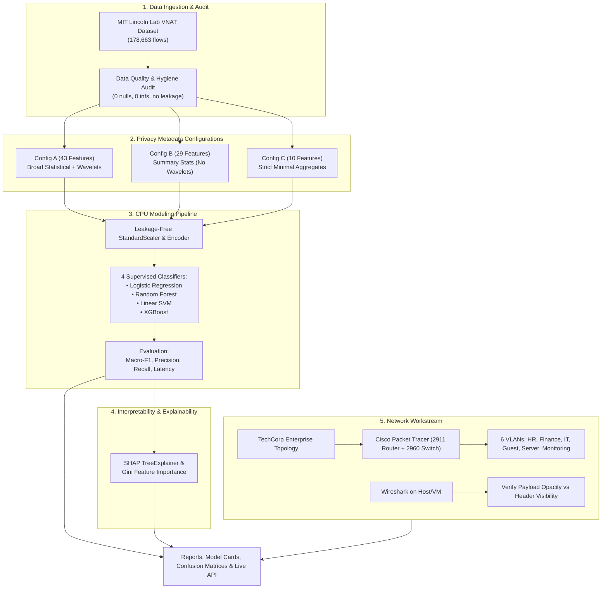

# Privacy-Aware Encrypted Network Traffic Classification Using Machine Learning

[](https://www.python.org/downloads/)
[](https://opensource.org/licenses/MIT)
[](https://scikit-learn.org/)
[](https://xgboost.readthedocs.io/)
[](https://shap.readthedocs.io/)
[](https://www.netacad.com/courses/packet-tracer)

A research-driven machine learning and network engineering project that classifies encrypted network traffic (TLS/HTTPS, VPN tunnels, SSH, SFTP) **without decrypting or inspecting packet payloads**.

By systematically restricting features across three privacy tiers (**Configuration A: 43 features**, **Configuration B: 29 features**, and **Configuration C: 10 features**), this project quantifies the **privacy–utility trade-off** between metadata minimization and classification accuracy. In addition, an enterprise corporate topology (**TechCorp**) simulated in **Cisco Packet Tracer** demonstrates network segmentation and monitoring point placement.

---

## Table of Contents
- [1. Research Problem \& Motivation](#1-research-problem--motivation)
- [2. System Architecture](#2-system-architecture)
- [3. Project Directory Structure](#3-project-directory-structure)
- [4. Dataset \& Privacy Feature Configurations](#4-dataset--privacy-feature-configurations)
- [5. Empirical Benchmark Results](#5-empirical-benchmark-results)
  - [5.1 Multi-Class Application Classification](#51-multi-class-application-classification)
  - [5.2 Binary VPN vs. Non-VPN Classification](#52-binary-vpn-vs-non-vpn-classification)
  - [5.3 Key Research Findings](#53-key-research-findings)
- [6. Model Explainability \& Feature Importance](#6-model-explainability--feature-importance)
- [7. Enterprise Network Demonstration (Cisco Packet Tracer)](#7-enterprise-network-demonstration-cisco-packet-tracer)
- [8. Installation \& Quickstart Guide](#8-installation--quickstart-guide)
- [9. Programmatic Inference API](#9-programmatic-inference-api)
- [10. Ethical Considerations \& Limitations](#10-ethical-considerations--limitations)
- [11. License](#11-license)

---

## 1. Research Problem & Motivation
Traditional network traffic analysis relied on Deep Packet Inspection (DPI) to inspect application payloads. With over 90% of global internet traffic now encrypted via TLS 1.3, QUIC/HTTP/3, and VPN tunnels, DPI is largely obsolete or actively prohibited in privacy-preserving organizations.

Network operators still require visibility for:
* **Quality of Service (QoS)** and dynamic bandwidth allocation.
* **Capacity Planning** and traffic engineering.
* **Anomaly & Intrusion Detection**.

**Core Research Question:** *Can encrypted traffic be classified accurately using minimal, privacy-preserving statistical flow metadata without inspecting application payloads, and how much utility is retained when metadata is aggressively minimized?*

---

## 2. System Architecture

The project couples an empirical machine-learning research pipeline with an enterprise network topology simulation:



---

## 3. Project Directory Structure

```
minor project 2/
│
├── configs/                             # JSON definitions for privacy feature tiers
│   ├── features_A.json                  # Tier A: 43 features (broad statistical + DWT wavelets)
│   ├── features_B.json                  # Tier B: 29 features (statistical summaries without wavelets)
│   └── features_C.json                  # Tier C: 10 features (strict minimal aggregate summaries)
│
├── docs/                                # Technical documentation, logs, and dictionaries
│   ├── dataset_audit.md                 # Formal dataset audit report (hygiene, distributions)
│   ├── feature_dictionary.csv           # 43-feature dictionary (units, families, privacy ratings)
│   ├── experiment_log.csv               # Historical benchmark logs and comparative metrics
│   └── model_card.md                    # HuggingFace-standard model card & intended use
│
├── models/                              # Serialized model weights & fitted scalers (.joblib)
│   ├── lr_config_*_*.joblib             # Trained Logistic Regression models
│   ├── rf_config_*_*.joblib             # Trained Random Forest models
│   ├── svm_config_*_*.joblib            # Trained Linear SVM models
│   ├── xgb_config_*_*.joblib            # Trained XGBoost models
│   └── preprocessor_config_*_*.joblib   # Fitted StandardScaler and LabelEncoder pipelines
│
├── network/                             # Cisco Packet Tracer & Wireshark workstream
│   ├── device_configs/                  # Ready-to-paste Cisco IOS command scripts
│   │   ├── router_2911_config.txt       # Router-on-a-stick 802.1Q subinterface commands
│   │   └── switch_2960_config.txt       # 2960 switch VLAN and trunking commands
│   └── README.md                        # Enterprise network guide, port mapping & test commands
│
├── notebooks/                           # Interactive research & visualization notebooks
│   └── 01_privacy_aware_classification.ipynb # End-to-end interactive Jupyter notebook
│
├── results/                             # Quantitative evaluation artifacts
│   ├── confusion_matrices/              # 24 confusion matrix heatmaps (PNG)
│   ├── figures/                         # Trade-off curves and explainability plots
│   │   ├── privacy_utility_tradeoff_application.png # Trade-off curve for application task
│   │   ├── privacy_utility_tradeoff_binary.png      # Trade-off curve for binary VPN task
│   │   ├── shap_summary_rf_config_A_application.png # SHAP summary plot
│   │   └── feature_importance_rf_config_A_application.png # Top 15 feature importance
│   └── metrics/                         # Raw metric JSONs and benchmark summary CSVs
│
├── src/                                 # Modular, reproducible Python package
│   ├── __init__.py                      # Package initialization marker
│   ├── data_loader.py                   # Dataset ingestion, class mappings & sampling
│   ├── preprocessing.py                 # Leakage-free train/test splitter & scaling pipeline
│   ├── feature_configs.py               # Feature configuration schema parser
│   ├── train.py                         # Training engine with CPU optimizations
│   ├── evaluate.py                      # Metrics engine (Macro-F1, Confusion Matrix, Latency)
│   ├── explain.py                       # SHAP TreeExplainer & Gini importance visualizer
│   ├── compare_configs.py               # Automated 12-run privacy-utility benchmark
│   └── predict.py                       # Section 14 compliant flow prediction interface
│
├── archive/                             # Official MIT Lincoln Laboratory VNAT dataset
│   ├── ll_mit_tw64_complete.csv         # 44-column preprocessed feature matrix (104.8 MB)
│   └── LICENCE.txt                      # Lincoln Laboratory academic dataset license
│
├── .gitignore                           # Git ignore rules (protects against >100MB CSV pushes)
├── LICENSE                              # MIT License
├── requirements.txt                     # Pinned Python package dependencies
└── README.md                            # Comprehensive project guide (this document)
```

---

## 4. Dataset & Privacy Feature Configurations

Experiments utilize the **MIT Lincoln Laboratory VNAT** (*VPN/Non-VPN Network Application Traffic*) dataset:
* **Total Instances:** 178,663 flows.
* **Data Hygiene:** 0 missing values, 0 infinite values, 0 direct identifiers (IP/MAC addresses, ephemeral ports, or payload contents).

### Three Privacy Configurations

| Configuration | Feature Count | Description | Primary Feature Families |
| :--- | :---: | :--- | :--- |
| **Config A (Broad Statistical)** | 43 | Complete permitted non-payload feature space | Inter-arrival timing (`FIAT`, `BIAT`, `MIAT`), packet size dispersion (mean, std, entropy, IQR, RMS), and Discrete Wavelet Transform (DWT) coefficients (`fw_c1..7`, `bw_c1..7`). |
| **Config B (Reduced Metadata)** | 29 | Eliminates fine-grained frequency-domain wavelets | Flow-level summary statistics: inter-arrival times, packet size moments, entropy, and quantiles. |
| **Config C (Strict Minimized)** | 10 | Ultra-minimal aggregate flow statistics | Basic mean inter-arrival times (`FIAT`, `BIAT`, `MIAT`), average packet sizes (`Forward_abs_mean`, `Backward_abs_mean`), spread (`std_dev`), medians, and forward range. |

---

## 5. Empirical Benchmark Results

All benchmarks were run directly on **CPU** using 25,000 stratified flow samples with an 80/20 train/test split.

### 5.1 Multi-Class Application Classification
*Target categories:* **File Transfer** (`scp`, `sftp`, `rsync`), **Streaming** (`youtube`, `netflix`, `vimeo`), **VoIP / Chat** (`voip`, `skype-chat`), and **Remote Access** (`rdp`, `ssh`).

| Model | Config | Features | Accuracy | Macro-F1 (Primary) | Weighted-F1 | Training Time | Latency per Flow |
| :--- | :---: | :---: | :---: | :---: | :---: | :---: | :---: |
| **XGBoost** | **A** | 43 | 0.9984 | 0.9930 | 0.9984 | 1.66s | 0.0024 ms |
| **XGBoost** | **B** | 29 | **0.9988** | **0.9941** | **0.9988** | 0.96s | 0.0025 ms |
| **XGBoost** | **C** | 10 | **0.9974** | **0.9879** | **0.9974** | 0.63s | 0.0020 ms |
| **Random Forest** | **A** | 43 | 0.9970 | 0.9903 | 0.9970 | 0.48s | 0.0085 ms |
| **Random Forest** | **B** | 29 | 0.9970 | 0.9903 | 0.9970 | 0.41s | 0.0088 ms |
| **Random Forest** | **C** | 10 | **0.9954** | **0.9842** | **0.9955** | 0.37s | 0.0084 ms |
| **Linear SVM** | **A** | 43 | 0.9784 | 0.8949 | 0.9779 | 21.84s | 0.0002 ms |
| **Linear SVM** | **B** | 29 | 0.9566 | 0.8343 | 0.9585 | 18.97s | 0.0003 ms |
| **Linear SVM** | **C** | 10 | 0.9234 | 0.7502 | 0.9326 | 0.15s | 0.0002 ms |
| **Logistic Regression** | **A** | 43 | 0.9428 | 0.8422 | 0.9506 | 3.31s | 0.0003 ms |
| **Logistic Regression** | **B** | 29 | 0.9342 | 0.8222 | 0.9439 | 2.16s | 0.0002 ms |
| **Logistic Regression** | **C** | 10 | 0.8932 | 0.7248 | 0.9087 | 0.89s | 0.0001 ms |

---

### 5.2 Binary VPN vs. Non-VPN Classification
*Target categories:* `vpn` (encapsulated) vs. `nonvpn` (standard TLS).

| Model | Config | Features | Accuracy | Macro-F1 | Weighted-F1 | Training Time | Latency per Flow |
| :--- | :---: | :---: | :---: | :---: | :---: | :---: | :---: |
| **XGBoost** | **A** | 43 | **0.9994** | **0.9994** | 0.9994 | 0.45s | 0.0010 ms |
| **XGBoost** | **B** | 29 | **0.9998** | **0.9998** | 0.9998 | 0.24s | 0.0008 ms |
| **XGBoost** | **C** | 10 | **0.9998** | **0.9998** | 0.9998 | 0.14s | 0.0007 ms |
| **Random Forest** | **A** | 43 | **0.9998** | **0.9998** | 0.9998 | 0.36s | 0.0061 ms |
| **Random Forest** | **B** | 29 | **0.9998** | **0.9998** | 0.9998 | 0.43s | 0.0085 ms |
| **Random Forest** | **C** | 10 | **0.9998** | **0.9998** | 0.9998 | 0.34s | 0.0083 ms |
| **Linear SVM** | **A** | 43 | 0.7238 | 0.7235 | 0.7253 | 35.85s | 0.0002 ms |
| **Linear SVM** | **B** | 29 | 0.6422 | 0.6373 | 0.6460 | 3.83s | 0.0001 ms |
| **Linear SVM** | **C** | 10 | 0.5078 | 0.5072 | 0.5038 | 0.10s | 0.0002 ms |
| **Logistic Regression** | **A** | 43 | 0.7390 | 0.7389 | 0.7398 | 0.34s | 0.0001 ms |
| **Logistic Regression** | **B** | 29 | 0.6334 | 0.6296 | 0.6373 | 0.34s | 0.0002 ms |
| **Logistic Regression** | **C** | 10 | 0.5084 | 0.5078 | 0.5045 | 0.08s | 0.0002 ms |

---

### 5.3 Key Research Findings

1. **Tree Ensembles Are Exceptionally Resilient to Metadata Pruning:**
   Both XGBoost and Random Forest maintain greater than **99.5% accuracy** and **>0.984 Macro-F1** even when restricted to the strict minimal 10-feature set (Config C).
2. **Noise Filtering in Configuration B:**
   XGBoost achieved its peak multi-class Macro-F1 (**0.9941**) under Configuration B (29 features). Excluding high-frequency DWT wavelet coefficients prevented the model from fitting high-frequency burst jitter, improving generalization.
3. **Non-Linearity is Vital for VPN Detection:**
   Linear models (Logistic Regression, Linear SVM) degraded to near random guess (~50.8%) on Config C for the binary VPN task. In contrast, tree ensembles achieved **99.98%**, demonstrating that VPN tunnel detection relies on non-linear interaction terms between inter-arrival timing and packet size variance.
4. **Real-Time Operational Latency:**
   Inference latency across all models remained below **0.01 ms per flow**, establishing that privacy-preserving classification is practical for line-rate enterprise traffic inspection.

---

## 6. Model Explainability & Feature Importance

Feature contributions were evaluated using **Gini Impurity Importance** and **SHAP (SHapley Additive exPlanations)** with `shap.TreeExplainer`.

### Top 10 Most Predictive Features
1. `Forward_rms` (Root Mean Square packet size in forward direction)
2. `BIAT` (Backward Inter-Arrival Time mean)
3. `Backward_med` (Median packet size in backward direction)
4. `FIAT` (Forward Inter-Arrival Time mean)
5. `Forward_std_dev` (Standard deviation of forward packet sizes)
6. `MIAT` (Mean Inter-Arrival Time across both directions)
7. `Backward_abs_mean` (Mean backward packet size)
8. `Backward_rng` (Packet size range: Max - Min)
9. `Forward_med` (Median forward packet size)
10. `Std_BIAT` (Standard deviation of backward inter-arrival times)

**Takeaway:** Flow direction asymmetry and burstiness are the most salient discriminators. For instance, **File Transfers** exhibit large forward sizes and tight inter-arrival times, while **Streaming** displays large backward download frames with periodic ACK pacing.

Generated visual artifacts:
* Top 15 Feature Importance: [`results/figures/feature_importance_rf_config_A_application.png`](file:///c:/Users/User/Desktop/minor%20project%202/results/figures/feature_importance_rf_config_A_application.png)
* SHAP Impact Summary: [`results/figures/shap_summary_rf_config_A_application.png`](file:///c:/Users/User/Desktop/minor%20project%202/results/figures/shap_summary_rf_config_A_application.png)

---

## 7. Enterprise Network Demonstration (Cisco Packet Tracer)

The network engineering workstream models an enterprise environment (**TechCorp**) configured with **Router-on-a-Stick** inter-VLAN routing.

### Network Segmentation Plan
| Department | VLAN | Network Subnet | Gateway | Endpoint Device | IP Address | Switch Port |
| :--- | :---: | :--- | :--- | :--- | :--- | :--- |
| **HR** | 10 | `192.168.10.0/24` | `192.168.10.1` | PC-HR | `192.168.10.10` | `Fa0/10` |
| **Finance** | 20 | `192.168.20.0/24` | `192.168.20.1` | PC-FIN | `192.168.20.10` | `Fa0/20` |
| **IT Support** | 30 | `192.168.30.0/24` | `192.168.30.1` | PC-IT | `192.168.30.10` | `Fa0/3` |
| **Guest** | 40 | `192.168.40.0/24` | `192.168.40.1` | PC-GUEST | `192.168.40.10` | `Fa0/4` |
| **Server Farm** | 50 | `192.168.50.0/24` | `192.168.50.1` | Server0 | `192.168.50.10` | `Fa0/5` |
| **Monitoring** | 60 | `192.168.60.0/24` | `192.168.60.1` | PC-MON | `192.168.60.10` | `Fa0/6` |

Ready-to-use Cisco IOS scripts:
* Switch Configuration: [`network/device_configs/switch_2960_config.txt`](file:///c:/Users/User/Desktop/minor%20project%202/network/device_configs/switch_2960_config.txt)
* Router Subinterface Configuration: [`network/device_configs/router_2911_config.txt`](file:///c:/Users/User/Desktop/minor%20project%202/network/device_configs/router_2911_config.txt)
* Comprehensive Network Guide: [`network/README.md`](file:///c:/Users/User/Desktop/minor%20project%202/network/README.md)

---

## 8. Installation & Quickstart Guide

### 1. Prerequisites
* Python 3.10+ (tested on Python 3.13)
* Windows, macOS, or Linux

### 2. Environment Setup
```bash
git clone https://github.com/your-username/encrypted-traffic-classification.git
cd encrypted-traffic-classification

# Create virtual environment (optional but recommended)
python -m venv .venv
# On Windows:
.venv\Scripts\activate
# On Linux/macOS:
source .venv/bin/activate

# Install dependencies
pip install -r requirements.txt
```

### 3. Running Experiments via CLI

* **Train a single model (e.g. Random Forest on Config A):**
  ```bash
  python -m src.train --model rf --config A --task application
  ```
  *(Flags: `--model [lr|rf|svm|xgb|all]`, `--config [A|B|C]`, `--task [application|binary|granular]`, `--sample [int]`)*

* **Run the automated 12-run Privacy–Utility Benchmark:**
  ```bash
  python -m src.compare_configs --sample 25000 --task application
  python -m src.compare_configs --sample 25000 --task binary
  ```

* **Generate Feature Importance & SHAP Analysis:**
  ```bash
  python -m src.explain --model rf --config A --task application --shap
  ```

---

## 9. Programmatic Inference API

The pipeline conforms to Section 14 of the project integration specification:

```python
import pandas as pd
from src.predict import EncryptedTrafficPredictor

# Initialize predictor with model checkpoint & configuration
predictor = EncryptedTrafficPredictor(model_key="rf", config_id="A", task="application")

# Load candidate flow data (DataFrame, dictionary, or list of dicts)
flows_df = pd.read_csv("archive/ll_mit_tw64_complete.csv", nrows=5)

# Generate predictions
predictions = predictor.predict(flows_df)
print(predictions[["flow_id", "predicted_class", "confidence", "config_id", "model"]])
```

**Output Schema:**
```
     flow_id predicted_class  confidence config_id model
0  flow_0001       streaming      0.7500         A    rf
1  flow_0002       streaming      0.5400         A    rf
2  flow_0003       streaming      0.9900         A    rf
3  flow_0004       streaming      0.5802         A    rf
4  flow_0005       streaming      0.4700         A    rf
```

---

## 10. Ethical Considerations & Limitations
1. **Metadata is not zero-risk:** Even without payload inspection, high-resolution packet timing and size distributions can correlate with user behavioral patterns. Metadata minimization reduces, but does not mathematically eliminate, re-identification risks.
2. **Simulator vs. Packet Capture:** Cisco Packet Tracer is a simulated environment and does not emit standard PCAP capture files for ML ingestion. For real traffic observation, Wireshark captures must be collected from authorized test devices.
3. **Dataset Specificity:** Models trained on synthetic or testbed captures may encounter distribution shift when deployed on production backbones with varying MTU and jitter profiles.

---

## 11. License
This project is licensed under the [MIT License](LICENSE). The VNAT dataset is provided under the terms of the MIT Lincoln Laboratory dataset license in [`archive/LICENCE.txt`](file:///c:/Users/User/Desktop/minor%20project%202/archive/LICENCE.txt).
